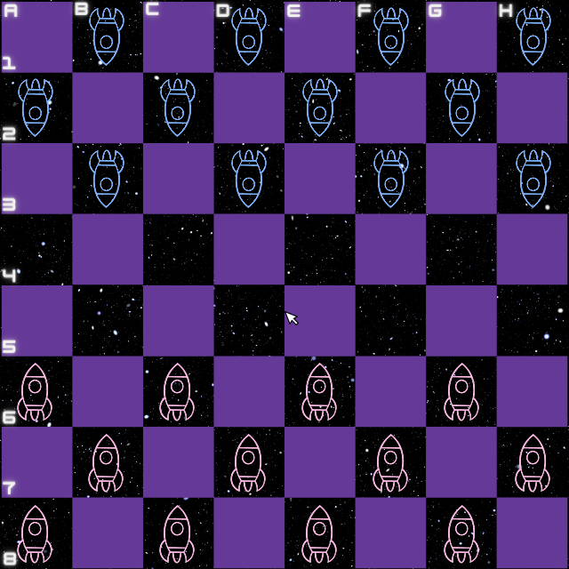

# Damas Espaciais · Space Checkers

[](https://github.com/Raiagues/Jogo-Damas-Espaciais/actions/workflows/build.yml)


A space-themed, local two-player checkers game written in **C with Allegro 5**. Originally developed as the final project for the **Algorithms and Programming** course in Aerospace Engineering at the **Federal University of Santa Maria (UFSM), Brazil**.

The project uses an 8 × 8 matrix to represent the board and validate moves. This repository includes the source code, original artwork and audio, a CMake build, and automated tests. The documentation is in English; text embedded in the original game artwork remains in Portuguese.

<p align="center">
  
</p>

## Download

**Without Git:** [Download the project ZIP](https://github.com/Raiagues/Jogo-Damas-Espaciais/archive/refs/heads/main.zip), extract it, and open a terminal in the extracted `Jogo-Damas-Espaciais-main` folder.

**With Git:**

```sh
git clone https://github.com/Raiagues/Jogo-Damas-Espaciais.git
cd Jogo-Damas-Espaciais
```

The download contains **source code**, not a ready-to-run installer. Build it using the instructions below. All game images and sounds are included; no Dropbox download is required.

## Build and run

Requirements: a C99 compiler, CMake 3.16 or newer, pkg-config, and Allegro 5.2 with its **image, primitives, audio, and audio codec** addons. Playing requires a graphical desktop and a mouse with left and right buttons.

### Windows — MSYS2 UCRT64

1. Install [MSYS2](https://www.msys2.org/), then open the **MSYS2 UCRT64** terminal from the Start menu.
2. Update the packages:

   ```sh
   pacman -Syu
   ```

   If prompted to close the terminal, reopen **MSYS2 UCRT64** and run the command again.

3. Install the compiler and dependencies:

   ```sh
   pacman -S --needed mingw-w64-ucrt-x86_64-gcc mingw-w64-ucrt-x86_64-cmake mingw-w64-ucrt-x86_64-ninja mingw-w64-ucrt-x86_64-pkgconf mingw-w64-ucrt-x86_64-allegro
   ```

4. In the same terminal, enter the downloaded project folder. For example, a folder in `C:\Users\YourName\Downloads` is accessible as `/c/Users/YourName/Downloads`:

   ```sh
   cd /c/Users/YourName/Downloads/Jogo-Damas-Espaciais-main
   cmake -S . -B build -G Ninja -DCMAKE_BUILD_TYPE=Release
   cmake --build build
   ./build/damas-espaciais.exe
   ```

Run from **UCRT64** so Windows can find the Allegro DLLs. The old Code::Blocks project is preserved in `legacy/` for historical reference; it depends on an obsolete, machine-specific Allegro installation.

### Ubuntu / Debian

```sh
sudo apt-get update
sudo apt-get install build-essential cmake pkg-config liballegro5-dev liballegro-image5-dev liballegro-audio5-dev liballegro-acodec5-dev
cmake -S . -B build -DCMAKE_BUILD_TYPE=Release
cmake --build build --parallel
./build/damas-espaciais
```

CMake copies `imagens/` and `sons/` beside the executable. Keep those folders with it if you move the build elsewhere. The game resolves resources relative to its executable, so it can be launched from another working directory.

To play without audio:

```sh
./build/damas-espaciais --no-audio
```

On Windows, use `./build/damas-espaciais.exe --no-audio`.

## How to play

Choose **Jogar** (*Play*) to start, or **Regras** (*Rules*) to view the original instructions. The countdown lasts ten seconds. Two people play on the same computer; blue moves first from the top of the board.

| Control | Action |
| --- | --- |
| Left-click your piece | Select it; a yellow border marks the selection. |
| Right-click a destination | Move the selected piece. |
| Right-click an adjacent opponent | Capture it if the square immediately beyond is empty. You can also click that landing square. |
| Right-click the selected piece | Pass the turn, as in the original project. |
| `Esc` | Return to the menu; from the menu, quit. A new game resets the board. |
| Close the window | Quit from any screen, including the countdown. |

The window title shows the current turn, both piece counts, and feedback on invalid moves. After a win, **Sim** (*Yes*) returns to the menu and **Não** (*No*) exits. **Voltar** means *Back*.

### Rules in this version

- Each player starts with 12 pieces on the dark squares.
- Regular pieces move one square diagonally forward: blue downward, pink upward.
- A capture jumps over one adjacent opponent into the empty square beyond. Regular pieces capture forward; kings capture in either direction.
- Reaching the opposite edge promotes a piece to a king. Kings move one diagonal square at a time.
- A turn consists of one move, one capture, or a pass. Captures are optional; there are no chained jumps in the maintained version.
- Once selected, a piece stays selected until a valid move or a pass. An invalid move leaves the board and turn unchanged.
- Win by capturing every opposing piece or leaving the next player without a legal move. Kings count toward the remaining pieces.

This is an educational checkers variant. It does not implement tournament rules, flying kings, mandatory capture, automatic draws, a computer opponent, online play, or saved games.

## Project structure

```text
src/
  main.c              Allegro window, menus, input, rendering, and audio
  game.c / game.h      Board state, moves, captures, promotion, and victory
imagens/              Original PNG artwork
sons/                 Original WAV audio
legacy/               Unmodified source and Code::Blocks project from the ZIP
tests/                Rule tests and Linux desktop smoke test
docs/                 Development notes and gameplay screenshot
CMakeLists.txt        Portable build and test configuration
LICENSE               GNU GPL v3 text supplied with the original project
```

## Tests and development

After building, run:

```sh
ctest --test-dir build --output-on-failure
```

The tests cover turns, invalid moves, captures, promotion, king counts, blocked players, restart, and board boundaries. GitHub Actions builds and tests on Linux and Windows; Linux also runs an automated desktop interaction test with memory checks.

See [development notes](docs/DEVELOPMENT.md) for architecture, graphical tests, and the changes from the original submission. The [original project notes](legacy/README.md) describe the preserved files.

## Troubleshooting

| Problem | What to check |
| --- | --- |
| CMake cannot find Allegro or pkg-config | Install the dependencies above. On Windows, use **UCRT64** and the `mingw-w64-ucrt-x86_64-` packages. |
| A DLL is missing on Windows | Start the game from the **MSYS2 UCRT64** terminal; moving only the `.exe` does not include its runtime libraries. |
| `Cannot load imagens/...` | Keep the copied `imagens/` folder beside the executable, or rebuild to copy the resources again. |
| No sound | Check the output device and `sons/`. The game remains playable when audio is unavailable. Use `--no-audio` to disable it explicitly. |
| The window cannot be created | Run from a graphical desktop with working graphics drivers. A plain SSH terminal has no display unless one is configured. |
| A move is rejected | Check whose turn it is, move diagonally, and leave the capture landing square empty. Regular pieces cannot move backward. |

## Credits and license

Developed for the UFSM Algorithms and Programming course, using the instructor's Pong example as the initial learning reference. Repository maintained by [Raiagues](https://github.com/Raiagues).

The original submission supplied the artwork, sound files, and GNU General Public License version 3 text. That license is preserved in [LICENSE](LICENSE). The original source and project file are retained unchanged in `legacy/`; the maintained implementation lives in `src/`.

Dependency references: [Allegro](https://liballeg.org/), [MSYS2 installation](https://www.msys2.org/), and the [MSYS2 UCRT64 Allegro package](https://packages.msys2.org/packages/mingw-w64-ucrt-x86_64-allegro).
